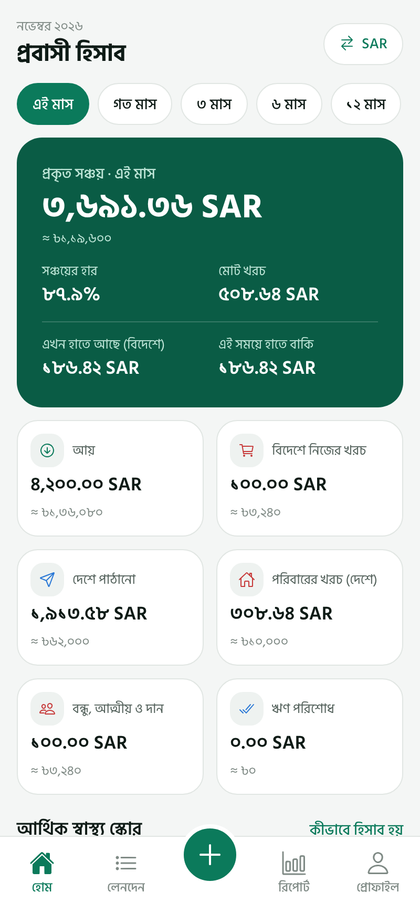
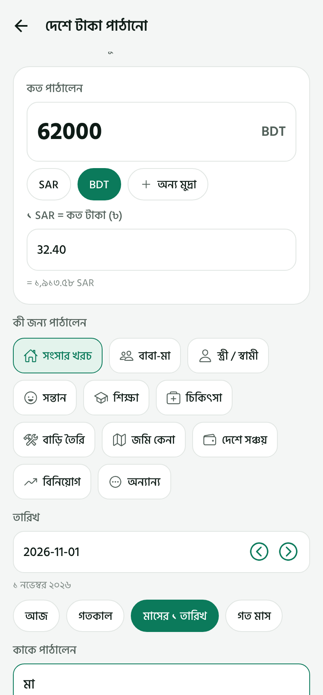
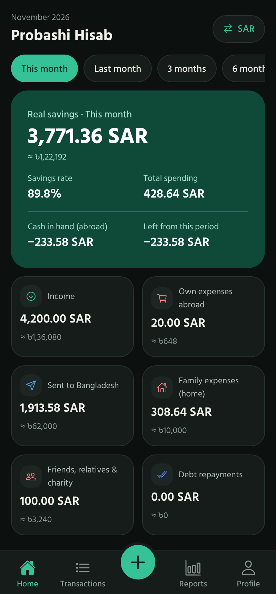

# প্রবাসী হিসাব · Probashi Hisab

বাংলাদেশি প্রবাসীদের জন্য অফলাইন, বাংলা-প্রথম টাকার হিসাবের অ্যাপ।
An offline, Bengali-first money manager for Bangladeshi expatriates.

**Status:** v0.1.0 — the six core modules work and are tested on the web build.
It has **not yet been run on an Android device**; see [DEVELOPMENT_STATUS.md](DEVELOPMENT_STATUS.md).

<p>
  
  
  
</p>

## What it does

| Module | What you get |
|---|---|
| **আয় / Income** | Salary, overtime, allowances, bonus, other; expected salary for comparison |
| **খরচ / Expenses abroad** | 22 categories (plus your own), payment method, budgets with warnings |
| **দেশে টাকা পাঠানো / Remittance** | Amount in your currency *or* in BDT, rate, fee, recipient, method, purpose, reference |
| **দেশের হিসাব / Home account** | Money sent in, family spending out, who spent it, running balance |
| **ধার ও ঋণ / Loans** | Lent and borrowed, repayments, outstanding, due date, instalment months |
| **সঞ্চয় / Savings goals** | Target, saved, remaining, %, estimated month at your recent pace |
| Dashboard | Real savings, savings rate, cash in hand, 6-month chart, where the money went, health score 0–100 with visible rules, insights |
| Reports | Any period, 12-month chart, by category, by recipient, CSV export |
| Calculators | Future savings (1/3/5/10 years), currency, remittance, debt payoff — each shows its formula |
| Other | Bengali / English, Bengali digits, light / dark, 12 currencies, demo mode, delete-all |

Three rules the app is built on:

1. **History never changes.** Each entry keeps the exchange rate of its own day.
2. **Nothing is counted twice.** Sending money home, lending, borrowing and saving are transfers, not spending or income.
3. **Your data stays on your phone.** No account, no network requests, no automatic backup (the app says so).

How these came out of the owner's spreadsheet: [docs/EXCEL_ANALYSIS.md](docs/EXCEL_ANALYSIS.md).

## Run it

```bash
cd probashi-hisab
npm install
npm run web          # in the browser
npm run android      # on a phone with Expo Go / a development build
```

Checks:

```bash
npm run check                        # typecheck + lint + 46 tests
npm run build:web                    # static web build into dist/
node e2e/serve.js dist &             # serves dist on :8099 with the headers SQLite-on-web needs
node e2e/flow.js                     # end-to-end run in headless Chromium (needs Playwright)
```

Android release builds need an Expo account (`npx eas-cli build -p android`); not set up yet.

## Layout

```
src/app      screens (Expo Router)
src/ui       design system, charts
src/i18n     Bengali (source) and English
src/store    Zustand store
src/db       SQLite schema, migrations, repository
src/domain   money, counting rules, summaries, health score, projections — pure and tested
__tests__    Jest: money, summaries, insights, repository on real SQLite
e2e          Playwright flow over the web build
docs         Excel analysis, architecture, database
```

Documents: [ARCHITECTURE](docs/ARCHITECTURE.md) · [DATABASE](docs/DATABASE.md) ·
[ROADMAP](ROADMAP.md) · [DEVELOPMENT_STATUS](DEVELOPMENT_STATUS.md)

## Not financial advice

The app keeps accounts. Projections are illustrations, not promises, and it gives no investment advice.
